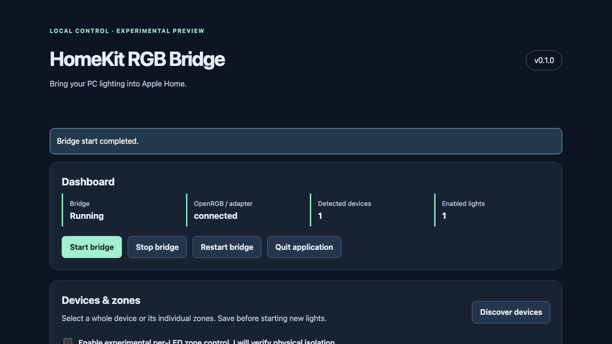

# HomeKit RGB Bridge

[](https://github.com/daqua22/homekit-rgb-bridge/actions/workflows/ci.yml)
[](LICENSE)

Control compatible PC RGB lighting from Apple Home. A local Windows application built with HAP-NodeJS and the OpenRGB SDK. No Homebridge, cloud account, telemetry or additional hardware.

**v0.1.0 experimental release candidate — publication requires maintainer approval.** This branch prepares a portable Windows x64 package with its own Node runtime, local configuration panel and background launcher. It is not an Apple-certified accessory, a native single-file executable, an installer, or a Windows service.


_Actual Chromium capture of the local configuration interface in mock mode. This screenshot does not demonstrate physical hardware._

## Features

- Local dashboard with bridge, adapter, pairing and accessory status; start/stop/restart controls and diagnostics.
- Device discovery, friendly HomeKit names, enable/disable and configuration without editing JSON.
- Optional experimental zone lights for valid per-LED layouts, including safe handling of empty zones.
- Logical groups with explicit partial-failure reporting; no silent group success.
- HomeKit on/off, hue, saturation and brightness; coalesced slider commands preserve the latest requested state.
- Private, explicit QR/PIN reveal; persistent pairing identity and backed-up configuration migrations.
- OpenRGB rediscovery, bounded reconnection and abandoned-lock recovery.
- User-level Windows sign-in startup and a hidden background launcher.
- Mock mode and synthetic protocol tests without hardware.

## Evidence and limits

The project maintainer verified Windows installation/build/lint, the original 43 tests, virtual-light pairing, physical SDK discovery, hardware-bridge pairing and **physical color control of two Corsair Vengeance RGB DDR5 modules**. OpenRGB 1.1 / SDK 6 was reported. This is maintainer-reported hardware evidence, separate from automated CI.

The iCUE LINK hub, Logitech mouse and Gigabyte motherboard were **discovered only**. Other devices, zone isolation, groups, brightness, software on/off, reconnect, reboot and sleep/wake have **not** been physically verified. See the [compatibility matrix](docs/hardware-compatibility.md) and [manual checklist](docs/manual-verification.md).

Power-off sends **black**, without cutting electrical power. Brightness scales RGB channels. Values are desired software state; protocol 3 provides no hardware-write acknowledgment. Zones require explicit experimental consent, a per-LED Direct mode, unique zone names and a complete LED partition; listed zones alone are insufficient. Whole-device and overlapping zone/group selections are rejected. Another application changing the same LEDs can defeat isolation/state assumptions.

**OpenRGB compatibility depends on exact hardware and firmware. Running OpenRGB alongside Corsair iCUE, Armoury Crate, Mystic Light or other RGB utilities can cause conflicts.** No iCUE adapter or low-level SMBus/fan/pump control is included.

## Requirements

- Windows 10/11 x64 for the portable package. Windows Script Host and a modern browser for its launcher/control panel.
- Separately installed OpenRGB with a local SDK server. For RGB RAM, follow OpenRGB's PawnIO and administrator-access instructions.
- An iPhone/iPad with Apple Home on the same trusted LAN; the PC must stay awake and running.
- A supported Node runtime and npm only for source development. Portable users need neither npm nor development tools.

## Install the Windows portable candidate

Until release approval, download `windows-x64-experimental-review` from a successful [PR/CI run](https://github.com/daqua22/homekit-rgb-bridge/actions) (GitHub sign-in may be required). No public Release is claimed.

1. Verify the portable ZIP's SHA-256 against the checksum file from the same build.
2. Extract the **entire** ZIP to a writable, stable application folder.
3. Double-click **Launch-Bridge.vbs**. Choose your private data directory. For an upgrade, choose the exact existing folder; a hardware profile may be `%LOCALAPPDATA%\HomeKitRGBBridge-Hardware`.
4. Configure OpenRGB and start its SDK server. In the control panel, choose the backend, discover devices, select/rename lights, confirm and save.
5. Start the bridge. Click **Reveal private pairing code & QR** and add it in Apple Home. Hide the credentials afterward.
6. Enable **Launch this profile at Windows sign-in** if desired. OpenRGB must start separately.

The launcher runs in the background, opens the browser through a private local handoff file and puts no pairing/admin secrets in process arguments. Closing the browser leaves the bridge running; **Quit application** shuts it down. No automatic firewall changes are made. Read [installation, upgrades and uninstall](docs/installation-windows.md) before using an existing installation.

## Source quick start

```powershell
git clone https://github.com/daqua22/homekit-rgb-bridge.git
cd homekit-rgb-bridge
npm ci
npm run build
npm run app
```

For a new simulated profile: `npm start -- init --mock`, then `npm run app`. Existing CLI commands remain available: `init`, `list`, `check`, `start --pairing`; all accept `--data-dir`. The admin interface prefers loopback port 8787 and falls back to a free port if busy. HomeKit defaults to 51826; user-selected ports such as 51827 are retained.

## Development and verification

```powershell
npm ci
npm run check
npm run format:check
npm run smoke
npm run test:browser
npm run licenses
npm run package:preview
npm run package:verify
# Windows x64 only:
npm run package:windows
npm run verify:windows
```

Install Chromium once with `npx playwright install chromium` for browser checks. CI validates Windows/Linux with Node 24/26, browser flows on Windows and Linux, and an extracted Windows package using the bundled runtime and hidden launcher. No workflow publishes a release from ordinary commits. See [development](docs/development.md) and [verification](docs/verification.md).

## Documentation

| Operation                                            | Reference                                                | Engineering                          |
| ---------------------------------------------------- | -------------------------------------------------------- | ------------------------------------ |
| [Getting started](docs/getting-started.md)           | [Configuration](docs/configuration.md)                   | [Architecture](docs/architecture.md) |
| [Windows installation](docs/installation-windows.md) | [Hardware compatibility](docs/hardware-compatibility.md) | [Development](docs/development.md)   |
| [Apple Home pairing](docs/apple-home-pairing.md)     | [Troubleshooting](docs/troubleshooting.md)               | [Verification](docs/verification.md) |
| [OpenRGB setup](docs/openrgb-setup.md)               | [FAQ](docs/faq.md)                                       | [Release process](docs/releases.md)  |

## Contribute and roadmap

Read [CONTRIBUTING.md](CONTRIBUTING.md), [CODE_OF_CONDUCT.md](CODE_OF_CONDUCT.md) and [SECURITY.md](SECURITY.md). Issue forms cover bugs, features and hardware reports. Contribute adapters behind `RGBAdapter`, with synthetic fixtures and truthful capability reporting.

Next gates: validate new zone/group behavior on physical devices, exercise fresh Windows 10/11 desktops and upgrades, test sign-in/reboot/sleep/wake, review the unsigned portable package, and obtain explicit release approval. Native tray/installer/service and arm64 distribution remain future work.

Original code is [MIT](LICENSE), by [Daniil Kozar](https://kozar.dev). [Dependency notices](THIRD_PARTY_NOTICES.md) are retained. Portable builds also include the unmodified Node runtime's complete license file. OpenRGB and drivers are not bundled.
