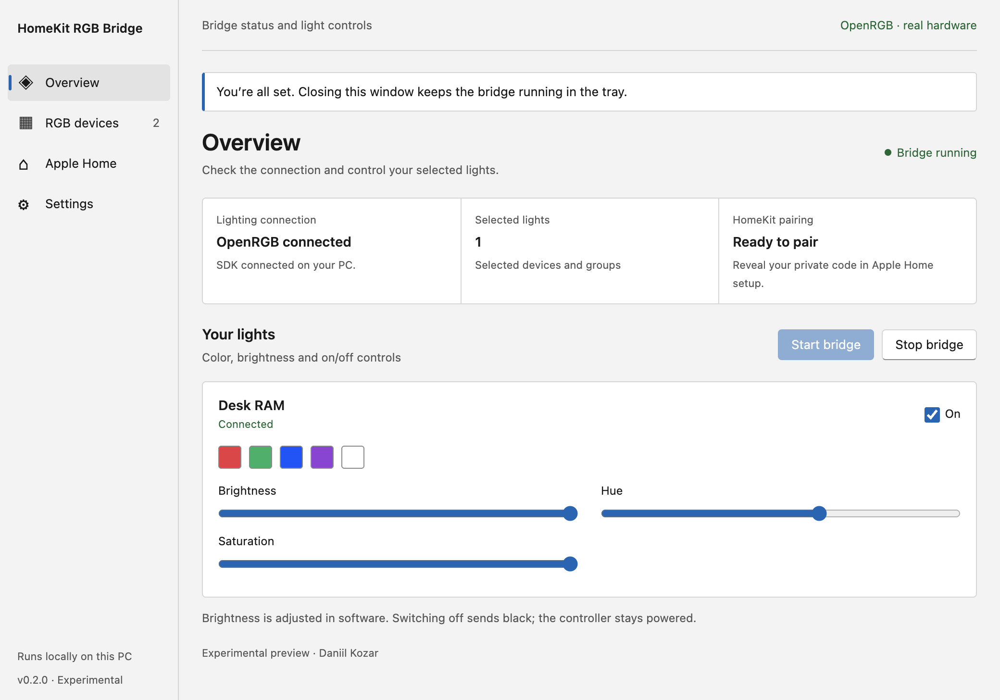

# HomeKit RGB Bridge

[](https://github.com/daqua22/homekit-rgb-bridge/actions/workflows/ci.yml)
[](LICENSE)

Your PC lighting, in Apple Home. A local Windows desktop app that connects compatible RGB hardware through OpenRGB. No Homebridge, cloud account, telemetry or additional hardware.

**V2 desktop edition · 0.2.0 experimental release candidate.** The new Windows EXE installer, guided interface, system tray and optional Windows startup are prepared for review. Public release publication requires maintainer approval.


_Actual Electron capture against synthetic SDK controllers. This is interface verification, not physical hardware evidence._

## What you get

- A Windows x64 installer and Start menu shortcut. No npm, system Node, browser URL or VBS launcher needed for everyday use.
- A simple path: connect OpenRGB → choose and name lights → add them to Apple Home.
- Compact Windows-style navigation and settings, system light/dark themes, color presets and software brightness/on-off controls.
- Close-to-tray operation, Start/Stop/Quit controls and optional quiet startup after Windows sign-in.
- A detected-profile picker to reuse earlier local HomeKit files, plus remembered connection and startup preferences; optional launch of an installed OpenRGB.
- Persistent HomeKit pairing, stable existing whole-device identities, private backups and explicit upgrade/profile handling.
- Advanced experimental zones and groups, with serialized commands and explicit partial-failure reporting.
- A protected local Node API and sandboxed desktop renderer. Setup credentials are revealed only on request.

## Download and set up

Until release approval, open a successful [CI run](https://github.com/daqua22/homekit-rgb-bridge/actions/workflows/ci.yml) for this branch and download **windows-desktop-v2-review** under Artifacts. GitHub sign-in can be required; review downloads expire after 30 days. No GitHub Release is claimed.

1. Extract the artifact ZIP and compare the installer against its checksum:

```powershell
Get-FileHash .\HomeKit-RGB-Bridge-0.2.0-Setup-x64.exe -Algorithm SHA256
Get-Content .\SHA256SUMS-desktop.txt
```

2. Run the EXE installer and open **HomeKit RGB Bridge** from the Start menu.
3. Already used the old bridge? In **Settings → Your profile**, choose its exact existing folder to retain pairing. Do not reset it.
4. Install/configure OpenRGB separately, verify that it detects your hardware and start its local SDK Server (normally `127.0.0.1:6742`). In the app choose **Connect & discover**.
5. Select/name devices, confirm and choose **Save lights & start bridge**.
6. Open **Apple Home** in the app, reveal the private code, then use **+ → Add Accessory** on your iPhone and assign rooms. Existing pairings do not need to be added again.
7. Finish setup and choose whether to start at Windows sign-in. Closing the window keeps the bridge running in the tray; Quit stops it.

Read [desktop setup, upgrades and uninstall](docs/desktop-v2.md). OpenRGB’s required hardware driver/access is a separate prerequisite; the app cannot automatically grant administrator permissions. The project installer is unsigned and may be blocked or warned about by Windows policy. No automatic firewall changes are made.

## Requirements and verified hardware

Windows 10/11 x64, separately installed OpenRGB, and an awake PC on the same trusted LAN as your iPhone/iPad. OpenRGB must detect the actual hardware. Manufacturer RGB apps such as Corsair iCUE can conflict with it. RAM may require the official PawnIO driver and elevated OpenRGB access.

The maintainer confirmed original Windows build/lint/tests, virtual/hardware Apple Home pairing and **physical Corsair Vengeance RGB DDR5 color control**. The iCUE LINK hub, Logitech G Pro Wireless and Gigabyte B650 AORUS ELITE AX ICE were discovered only. Physical independent zones, groups, brightness/off, recovery, the new desktop upgrade, sign-in/reboot and sleep/wake remain manual checks. See [compatibility](docs/hardware-compatibility.md) and [manual verification](docs/manual-verification.md).

Off sends black rather than cutting controller power. Brightness scales RGB channels. Protocol writes are not physical acknowledgments. Zones require explicit consent, safe per-LED Direct layouts and physical verification; listed zones alone do not establish support. The project is not Apple-certified. Control is unavailable while the PC is off/asleep. No native Windows service, automatic updater or arm64 build is provided.

## Development

This candidate is on `codex/desktop-v2`; the earlier candidate remains in a separate open PR. Do not assume these features are merged into `main`.

```sh
git clone https://github.com/daqua22/homekit-rgb-bridge.git
cd homekit-rgb-bridge
git checkout codex/desktop-v2
npm ci
npm run desktop
```

```sh
npm run check             # lint, types, unit/integration tests, build
npm run smoke             # real local HAP listener and persistence checks
npm run test:desktop      # Electron → official Node → synthetic SDK → HAP
npm run test:browser      # legacy local browser panel regressions
npm run licenses
npm audit
# Build and verify the EXE on Windows x64:
npm run desktop:windows
npm run verify:desktop:windows
```

Source development uses Node 24 (also accepts 22.15+/26). Desktop development launches the bridge under the host Node executable; installed Windows apps use their bundled official Node. Electron’s embedded crypto is incompatible with HAP-NodeJS, so the bridge deliberately runs separately. Chromium browser checks need `npx playwright install chromium` once. The old CLI/browser and runtime-portable package remain available for advanced use; see [development](docs/development.md).

## Documentation and contributions

[Desktop setup](docs/desktop-v2.md) · [Getting started](docs/getting-started.md) · [OpenRGB](docs/openrgb-setup.md) · [Pairing](docs/apple-home-pairing.md) · [Configuration](docs/configuration.md) · [Architecture](docs/architecture.md) · [Troubleshooting](docs/troubleshooting.md) · [FAQ](docs/faq.md) · [Release notes](docs/release-notes-v0.2.0.md)

Read [CONTRIBUTING.md](CONTRIBUTING.md), [CODE_OF_CONDUCT.md](CODE_OF_CONDUCT.md) and [SECURITY.md](SECURITY.md). Issue forms cover bugs, features and hardware compatibility; keep verified physical support separate from synthetic/community reports.

Next gates: exact-candidate Windows install/upgrade and physical Apple Home checks; independent zones/groups/brightness/off/recovery; sign-in/reboot/sleep/wake; maintainer release approval. A native service, automatic updater and arm64 distribution are future work.

Original project code is [MIT](LICENSE), by [Daniil Kozar](https://kozar.dev). [Runtime dependency notices](THIRD_PARTY_NOTICES.md) are retained. Desktop distributions also retain Electron/Chromium and the official Node runtime licenses. OpenRGB and drivers are installed separately and are not redistributed.
