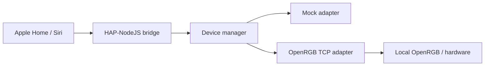

# HomeKit RGB Bridge

[](https://github.com/daqua22/homekit-rgb-bridge/actions/workflows/ci.yml)
[](LICENSE)

Control your PC's RGB lighting through Apple Home. A small, local TypeScript bridge between HAP-NodeJS and a separately running OpenRGB SDK server. No Homebridge, cloud account or extra hardware.

**Experimental development preview · Windows target · no hardware verified yet.** This is a Node.js CLI application, not a standalone `.exe`, installer, Windows service, or Apple-certified HomeKit accessory. No tagged release has been published. Apple Home pairing, Windows startup and physical RGB operation still need the [manual verification checklist](docs/manual-verification.md).



## What works in software

- HomeKit Lightbulb accessories with on/off, hue, saturation and brightness handlers.
- A mock RGB light for development without hardware.
- OpenRGB protocol-3 negotiation, device/zone discovery and whole-device RGB updates.
- Explicit device opt-in, stable identities, persistent desired state and HAP pairing storage.
- Bounded reconnect backoff, device disappearance handling and clean signal shutdown.
- Per-installation random setup code and terminal QR, shown only with `--pairing`.
- Automated unit, HAP handler, TCP protocol, runtime smoke and packaging checks.

**Limits:** only controllers advertising a **Direct** mode with per-LED color are eligible. Zones are listed but V1 sets one color across the entire device. Brightness scales RGB channels; off sends black. Neither cuts electrical power. Values represent the last transport-accepted desired state; there is no verified physical readback or synchronization with other RGB apps. Protocol 3 has no hardware-write acknowledgment. Identical controllers without distinct serial/location are rejected.

OpenRGB compatibility depends on the exact controller, firmware and OpenRGB version. **Running OpenRGB alongside Corsair iCUE, Armoury Crate, Mystic Light or other manufacturer RGB software can cause conflicts.** No iCUE adapter is included. See [hardware compatibility](docs/hardware-compatibility.md).

## Requirements

- Windows 10/11, a supported Node.js runtime (Node 24 recommended) and npm.
- For actual RGB: separately installed OpenRGB supporting SDK protocol 3 or newer, with the SDK server listening locally on TCP 6742.
- An iPhone/iPad with Apple Home on the same trusted LAN; multicast DNS must work.
- PC powered on and awake. Remote access/automations depend on Apple's home hub setup.

## Quick start: virtual light

In PowerShell:

```powershell
git clone https://github.com/daqua22/homekit-rgb-bridge.git
cd homekit-rgb-bridge
npm ci
npm run build
npm start -- init --mock
npm start -- list
npm start -- start --pairing
```

In Apple Home, choose **+ → Add Accessory**, then scan the private terminal QR or enter its setup code. Accept the uncertified-accessory prompt if offered. Pairing has not yet been tested with a physical iPhone. Keep this terminal private; never post its QR, setup URI or setup code. Use `npm start` for subsequent normal runs. Stop with Ctrl+C.

## Connect real hardware

Start with a separate data directory if you already created a mock setup:

```powershell
npm start -- init --data-dir "$env:LOCALAPPDATA\HomeKitRGBBridge-Hardware"
npm start -- list --data-dir "$env:LOCALAPPDATA\HomeKitRGBBridge-Hardware"
```

Edit that directory's `config.json`: copy the desired device's `id` from `list` into `devices`, set a friendly `name` and `enabled: true`. Then run:

```powershell
npm start -- check --data-dir "$env:LOCALAPPDATA\HomeKitRGBBridge-Hardware"
npm start -- start --pairing --data-dir "$env:LOCALAPPDATA\HomeKitRGBBridge-Hardware"
```

Follow [OpenRGB setup](docs/openrgb-setup.md) before enabling hardware. Listing never changes colors. Starting the bridge applies saved desired states (new lights start off), switches selected controllers into Direct mode and may replace manufacturer effects.

## Install and operate

[Windows installation and startup](docs/installation-windows.md) covers source installation, Node preview archives, Task Scheduler, upgrade and uninstall. No download or standalone-executable claims are made. Preview archives, when built, contain compiled JavaScript and require a separate Node installation plus `npm ci --omit=dev --ignore-scripts`.

Configuration and pairing data live in `%LOCALAPPDATA%\HomeKitRGBBridge` by default, outside the repository. On macOS/Linux development machines: `~/.homekit-rgb-bridge`. Back up this entire private directory before an upgrade; protect it as credentials. Restrict Windows folder access as described in [security](SECURITY.md).

## Development

```powershell
npm ci
npm run check
npm run format:check
npm run smoke
npm run licenses
npm run package:preview
npm run package:verify
```

`npm run check` runs ESLint, strict TypeScript checks, Vitest and compilation. CI runs on Windows and Linux with Node 24 and 26. Packaging does not publish anything. Tests use a mock adapter and synthetic local SDK server; they do not certify real hardware.

## Documentation

| Start here                                           | Reference                                                | Engineering                                        |
| ---------------------------------------------------- | -------------------------------------------------------- | -------------------------------------------------- |
| [Getting started](docs/getting-started.md)           | [Configuration](docs/configuration.md)                   | [Architecture](docs/architecture.md)               |
| [Windows installation](docs/installation-windows.md) | [Hardware compatibility](docs/hardware-compatibility.md) | [Development](docs/development.md)                 |
| [Apple Home pairing](docs/apple-home-pairing.md)     | [Troubleshooting](docs/troubleshooting.md)               | [Manual verification](docs/manual-verification.md) |
| [OpenRGB setup](docs/openrgb-setup.md)               | [FAQ](docs/faq.md)                                       | [Release process](docs/releases.md)                |

No screenshots or physical-device demonstrations are supplied: none have been verified. See [validation evidence](docs/verification.md) for the precise tested scope.

## Contribute

Read [CONTRIBUTING.md](CONTRIBUTING.md), [CODE_OF_CONDUCT.md](CODE_OF_CONDUCT.md) and [SECURITY.md](SECURITY.md). Use GitHub Issues for bugs, features and hardware reports. Reports distinguish maintainer-verified hardware from unverified community claims. A future adapter can implement `RGBAdapter` without changing HomeKit handlers.

## Roadmap

- Complete Apple Home + Windows 10/11 + physical-device verification.
- Publish an explicitly experimental `v0.1.0` only after preview gates pass.
- Expand compatibility fixtures and review direct-mode variants.
- Evaluate zone selection, tray UI, installer and service operation after the core is validated.
- Investigate other backends, including iCUE, as separate work.

## License and author

Original code: [MIT](LICENSE). Runtime dependencies keep their own licenses; see [license review](docs/dependency-licenses.md) and [third-party notices](THIRD_PARTY_NOTICES.md). OpenRGB and Node.js are not bundled.

Created by [Daniil Kozar](https://kozar.dev).
