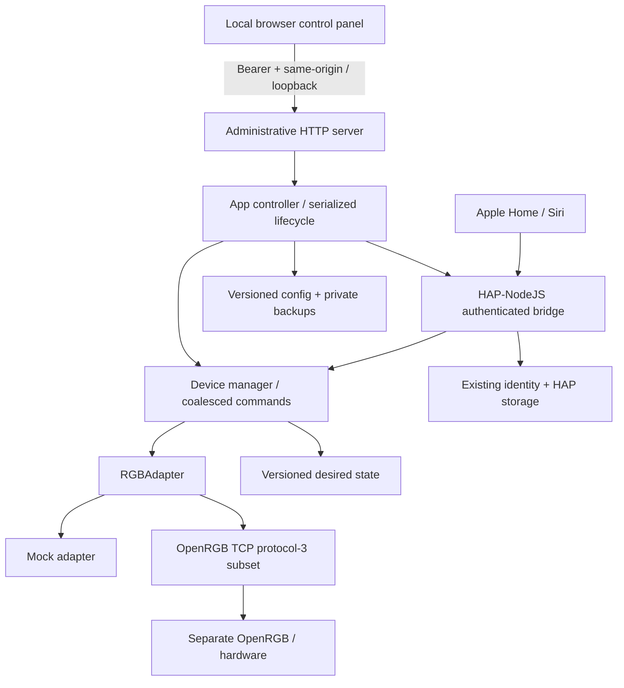

# Architecture

`src/app` adds lifecycle/UI administration around the existing bridge. `src/homekit` keeps original UUID seeds and HAP storage paths. `src/devices` serializes inventory, restoration and writes; HomeKit/UI requests coalesce for 35 ms. `src/adapters` remains independent of HAP. A future backend need not change characteristic handlers. `src/windows` creates scoped user-level background Startup launchers, without privilege elevation.

The admin server binds 127.0.0.1, validates exact Host/Origin, requires a random bearer for every API, rejects cross-site requests/preflight, limits request bodies/rates/timeouts, serves an asset allowlist and uses a restrictive CSP. No cookie authentication/CORS or public configuration endpoint exists. A private local HTML handoff supplies the token in a URL fragment; the UI immediately removes it from the URL and uses tab session storage. Pairing credentials require an explicit POST and are not in dashboard/log output. See [SECURITY.md](../SECURITY.md).

## Compatibility-preserving persistence

Version-0 config/state load into version-1 representations without writes. Explicit confirmed config Save checks a file revision, backs up config/state/identity/HAP storage and writes version 1. Legacy state is backed up before its first new-format write. Identity and HAP keys stay untouched except the deliberate confirmation-protected reset. Unknown future versions fail closed. Whole-device UUID seeds, state keys and user ports remain unchanged. HAP storage is process-global; changing profile/resetting keys requires a new process.

An atomic heartbeat directory lock coordinates new processes and recovers abandoned owners after 10 seconds. A legacy PID marker also blocks older CLI versions. Live/permission-ambiguous legacy PIDs are never silently stolen; reused PIDs may require manual inspection. Files use private creation modes where POSIX supports them; Windows relies on inherited/reviewed NTFS ACLs.

## OpenRGB and zones

The independent adapter follows the [upstream SDK specification](https://gitlab.com/CalcProgrammer1/OpenRGB/-/blob/master/Documentation/OpenRGBSDK.md) and checks [controller layout semantics](https://gitlab.com/CalcProgrammer1/OpenRGB/-/blob/master/RGBController/RGBController.cpp). No upstream GPL implementation or binary is copied. Client version 3 and version-3 controller layouts are explicit, even when a server advertises 6. Unsupported older versions fail. One request is outstanding at a time; TCP fragmentation, magic/size limits (8 MiB), truncated layouts, counts (up to 512 controllers), request/write timeouts and unsolicited inventory invalidation are handled.

Stable whole IDs remain hashes of vendor/name/type/serial-or-location, never enumeration index. Duplicate identities are rejected. Zone IDs hash unique zone names under their parent; reorder updates range routing without changing IDs. Layout changes, missing devices and renamed/ambiguous zones become unavailable rather than guessing.

Direct/per-LED mode and matching color/LED counts gate whole-device control. Zone eligibility additionally requires no entire-device-only flag, a complete zone/LED partition and nonempty uniquely named zones. The SDK's zone method exists but its availability does not establish physical support. Full-buffer range merging preserves all untouched bytes and uses the already supported UpdateLEDs path. Mode is initialized once per connection/controller index; reconnect invalidates it. Physical firmware isolation is still experimental and requires explicit opt-in and manual evidence.

## Groups, failures and lifecycle

Each target belongs to at most one enabled light/group. Whole and child zones cannot overlap. Group writes are serialized; accepted member states persist, failed members are recorded and group success/state is withheld unless all succeed. No automatic rollback is attempted after uncertain writes. There is no protocol-3 hardware acknowledgment or physical readback. Values are software desired state, and external RGB writers are not synchronized.

The reconnect loop doubles delay to a configured cap, disconnects on errors and re-enumerates before restoration. No parallel reconnect loop is created by UI reads. SIGINT/SIGTERM and authenticated Quit drain work, unpublish HAP, disconnect and release locks. Windows API Quit is graceful even though external forced process termination cannot be. An abandoned heartbeat lock enables later crash recovery. Sleep/wake and actual sign-in/reboot behavior remain physical manual tests, not inferred from CI.

## Distribution

The portable Windows x64 build retains modular JavaScript/dependencies and bundles a SHA-256-pinned official Node executable and full runtime license. It avoids relying on experimental SEA features, native installer privileges or downloaded code at runtime. CI extracts and runs it with the bundled runtime, exercises mock HAP/state/API lifecycle and executes the hidden VBS launcher. No system Node/npm is required for operation. OpenRGB/PawnIO remain separate prerequisites.
