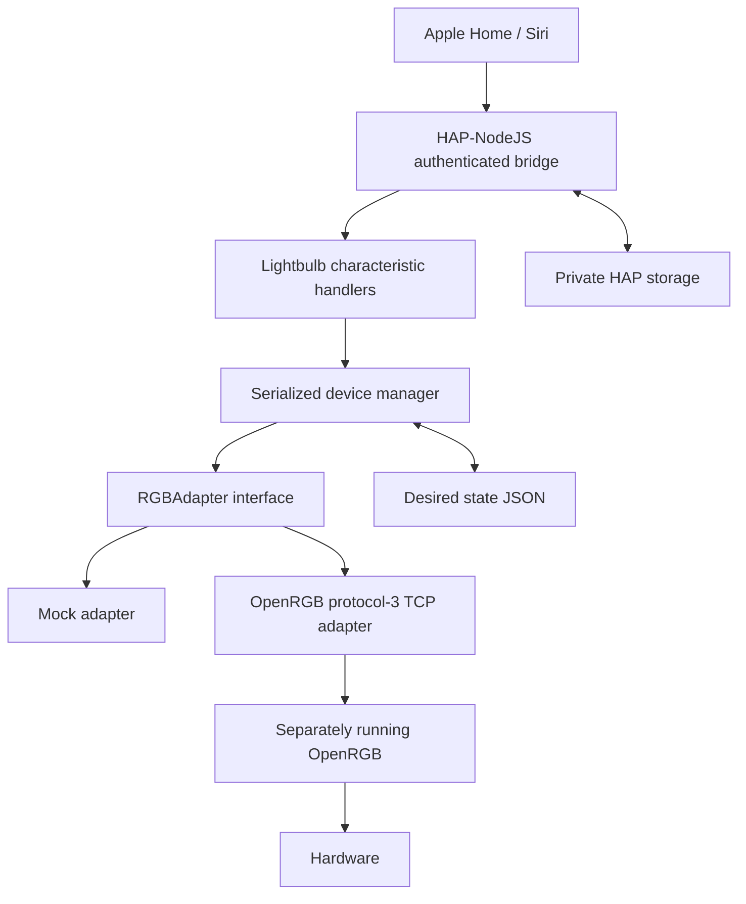

# Architecture

`src/homekit` creates one bridge and one Lightbulb per enabled configured ID. `@homebridge/hap-nodejs` owns discovery, HAP encryption, pairing, characteristic encoding and stable AID/IID storage. UUIDs derive from a device ID rather than list position; the bridge identity is random and persistent. Setup credentials use Node cryptographic randomness. No HomeKit protocol is reimplemented.

`src/devices/device-manager.ts` serializes inventory refresh, state changes and restoration. This prevents simultaneous HomeKit characteristic writes from overwriting each other's hue/brightness updates. The state store validates complete state, atomically replaces its JSON and updates memory only after disk success. State is desired output accepted by the TCP transport, not a sensor reading.

`RGBAdapter` exposes connection, enumeration, capabilities and whole-device RGB writes. Software HSV/value conversion belongs above this boundary, so another backend does not need to understand HAP. No iCUE implementation is shipped. The supported V1 subset has color plus software power/brightness; unsupported controllers remain unavailable rather than silently accepting commands.

## OpenRGB protocol boundary

This is an independently implemented, bounded subset of the [upstream SDK protocol](https://gitlab.com/CalcProgrammer1/OpenRGB/-/blob/master/Documentation/OpenRGBSDK.md), checked against [RGBControllerInterface](https://gitlab.com/CalcProgrammer1/OpenRGB/-/blob/master/RGBController/RGBControllerInterface.h). No OpenRGB source implementation or GPL binary is incorporated. Packet fields are encoded little endian; controller parsing uses explicit bounds checks.

- Negotiate maximum client version 3, reject servers below 3, request controller data using version 3.
- Use one outstanding request and serialize discovery/updates. Validate packet magic, lengths, controller counts (maximum 512) and controller size.
- Limit an individual packet to 8 MiB. Malformed/truncated layouts fail rather than being guessed.
- Enumerate names, vendors, serial/location (used locally for hashes), modes, zones and LED counts. Only expose sanitized metadata and hashed IDs from `list`.
- Require an advertised `Direct` mode with flag bit 5 (per-LED color), nonzero LEDs and equal LED/color counts. Set this mode through UpdateMode, maximize mode brightness and send UpdateLEDs for the entire device.
- Derive ID from vendor, name, device type and serial, falling back to location. Ambiguous identical hashes are rejected, never disambiguated by a shifting index.
- Immediately close on inventory-change notification (packet 100); reconnect and re-enumerate before further commands. Periodically refresh to detect silent changes. Protocol 3 indices cannot prevent every server-side race if a server changes indices without a timely notification; multiple-device hotplug needs manual verification.
- Successful writes have no protocol-3 acknowledgment or physical readback. The bridge must not advertise hardware confirmation.

## Recovery and shutdown

A single timer refreshes inventory. Failure clears availability, disconnects and schedules delays that double to a configured maximum (default 1s, 2s, 4s … 30s), with no parallel reconnect loops. Only the transition into failure is logged; debug command events contain no private values. On restoration, saved desired states are applied before lights become usable. Get/set requests while unavailable return HAP communication errors.

SIGINT/SIGTERM trigger HAP unpublish, draining queued work, adapter disconnect and lock removal. A crash, forced termination or abrupt power loss can leave a lock; recovery is intentionally manual after checking the process is gone. Windows autostart uses Task Scheduler under the user, not a built-in service. No schema migrations or automatic lock stealing are implemented.

## Evidence boundaries

Synthetic SDK fixtures prove packet handling for tested layouts; they are not hardware captures. Real HAP socket smoke checks prove authentication is required and local storage survives process restarts; they do not prove pairing with Apple Home. See [verification](verification.md) and [manual verification](manual-verification.md).
