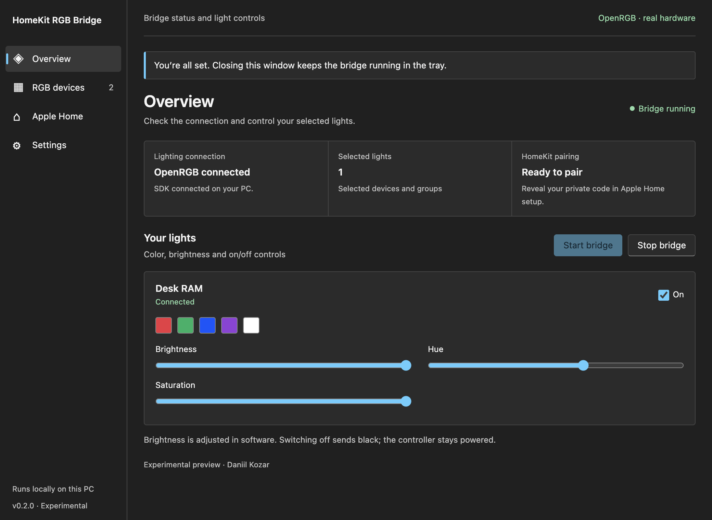

# V2 desktop edition (0.2.0 experimental candidate)

V2 is a Windows x64 desktop app, with an EXE installer, Start menu/desktop shortcuts, a local interface, system tray and optional Windows sign-in startup. It bundles Electron for the interface and an unmodified, checksum-pinned official Node runtime for the bridge. No system Node, npm or user-run launcher is needed for ordinary use. Optional administrator startup setup uses the built-in Windows PowerShell and Task Scheduler.

The Windows installer is a review artifact until the maintainer approves publication. Use only the exact successful `desktop-windows` CI artifact, `windows-desktop-v2-review`. GitHub sign-in can be required and these review artifacts expire after 30 days. There is no automatic update or release publication.

## Interface

The interface uses a compact Windows-style layout: system fonts, flat navigation, standard visible checkboxes, concise status rows and light/dark colors that follow the system theme. Overview contains the connection status and light controls; RGB devices selects what Apple Home exposes; Apple Home contains pairing; Settings contains startup, connection and profile options. Advanced and destructive actions remain collapsed.

This is still an Electron interface with a native operating-system window frame and file dialogs. It does not use WinUI or native Windows controls for its content. The design change preserves the existing Node sidecar, settings and pairing storage.

The screenshot is captured from the running Electron app against a synthetic SDK server; it does not verify physical hardware.

## Install and connect

1. Download the review artifact from a successful [CI run](https://github.com/daqua22/homekit-rgb-bridge/actions/workflows/ci.yml), extract its download ZIP and compare the installer’s SHA-256 with `SHA256SUMS-desktop.txt`.
2. Run `HomeKit-RGB-Bridge-0.2.0-Setup-x64.exe`. It installs for your Windows user and creates shortcuts. The project does not sign the EXE; verify its source/checksum. Follow your organization’s security policy if unsigned software is blocked.
3. Open **HomeKit RGB Bridge** from the Start menu. A new profile defaults to OpenRGB, with no demo lights and no empty HomeKit bridge published.
4. Already used v1? Before selecting lights, open **Settings → Your profile → Find existing profiles** (or **Choose existing profile** in the setup banner). The app lists detected folders with their bridge names, selected-light counts and whether local HomeKit files exist. Choose **Use profile & restart** on the profile you used before. Common folders are `%LOCALAPPDATA%\HomeKitRGBBridge` and `%LOCALAPPDATA%\HomeKitRGBBridge-Hardware`. If yours is not listed, choose **Browse for another folder** and select the exact folder containing its `config.json`. Never copy pairing keys into the installation directory.
5. OpenRGB remains a separate prerequisite. It must detect your hardware and have its SDK Server listening locally, normally `127.0.0.1:6742`. In the app choose **Connect & discover**. Mock profiles show a clear banner and require explicit confirmation to switch to hardware; there is no silent fallback to mock mode.
6. Select devices, give them names, confirm the selection and choose **Save lights & start bridge**. A private backup is created. New lights initially receive black until switched on.
7. In **Apple Home**, reveal the private pairing QR/PIN only when ready. On your iPhone use **+ → Add Accessory**, then assign rooms to each light. The bridge itself is listed under **Home Settings → Home Hubs & Bridges**. A paired bridge with zero enabled lights has no light tiles; V2 prevents new empty-bridge starts.
8. Choose **Finish setup**. On the installed Windows app, its startup checkbox controls whether the desktop app starts quietly after sign-in. You can change this later in Settings.

## Finding an earlier pairing

Profile discovery checks the current/default folder, neighboring `HomeKitRGBBridge-*` folders and custom paths recorded by recognized bridge Startup launchers for this Windows account. **Search again** refreshes the list. Discovery reads configuration metadata and checks for identity/HomeKit files; it does not read pairing-key contents, merge profiles, or select a different profile automatically.

A folder with HomeKit files is not proof that Apple Home is still paired. The running bridge reports its pairing status after opening that profile. Profiles with unreadable configuration/storage or HomeKit storage without the original `identity.json` are marked unavailable; restore missing original files from a private backup instead of resetting pairing.

A profile on another drive, under another Windows account or in an arbitrary custom location may require **Browse for another folder**. The app cannot recover local pairing keys from your iPhone or iCloud. If the original files were deleted, automatic detection cannot recreate the previous pairing.

## Start everything after Windows sign-in

For USB lighting that works without administrator access, leave **Start quietly when I sign in to Windows** and **Start OpenRGB automatically with the bridge** checked when finishing setup. Select the installed OpenRGB.exe if prompted. In Settings these options are **Launch at sign-in** and **Open OpenRGB when needed**.

For RAM that requires elevated OpenRGB access:

1. Install OpenRGB normally under **Program Files**, and install the official [PawnIO driver](https://pawnio.eu/) once. OpenRGB must already detect the hardware when run as administrator; the bridge cannot add unsupported hardware.
2. In the installed bridge, use **Settings → Locate OpenRGB.exe** if the executable was not detected.
3. Choose **Set up automatic Windows startup** and approve the one-time Windows administrator prompt. Use the same administrator account you sign into Windows with. The app verifies registration before marking setup complete.
4. At subsequent sign-ins, Windows starts OpenRGB with the required privileges and starts the bridge quietly in its tray. No administrator password is stored and no per-boot UAC prompt is requested by this setup. This is **after sign-in**, not before the login screen.

The optional task is named `HomeKitRGBBridge-OpenRGB-<account hash>`, is tied to the current user's interactive sign-in, runs the selected OpenRGB executable with fixed local SDK arguments and ignores concurrent task instances. The bridge remains a normal-user process. Elevated recurring startup requires an administrator-protected installation inside Program Files; editable/redirected executable locations are rejected. Re-run setup after changing the OpenRGB executable or SDK host/port. A standard Windows account cannot obtain unattended administrator execution through this feature.

Use only one OpenRGB startup mechanism: disable older manually configured OpenRGB startup entries/tasks separately. Existing unrelated tasks are not overwritten. If an ordinary-user OpenRGB copy is already running, close it once and sign out/in to apply the new elevated startup mode. The bridge does not terminate existing RGB apps.

The bridge waits up to 30 seconds for the SDK port after launch, coalesces its own concurrent launch requests, and reuses an existing listener. An existing OpenRGB process without a working SDK is not duplicated; enable its SDK Server. Slow hardware detection can require more time and a retry. The existing bridge reconnect loop continues trying to recover saved lights.

Settings shows OpenRGB launch progress and PawnIO installation status. **Check required apps** repeats read-only checks; **Get PawnIO** opens the official site. PawnIO is a kernel driver, not a separate app window that must be opened each boot. Its detected installation alone does not prove hardware access. OpenRGB/PawnIO are not bundled or installed automatically. Close iCUE and other competing RGB apps.

**Disable automatic Windows startup** removes this bridge's login entry and, when configured, requests one-time approval to remove its managed OpenRGB task. A full uninstall also removes that task; if approval is canceled or removal cannot be verified, uninstall stops so the managed task is not abandoned. Upgrades preserve startup registration. OpenRGB and PawnIO remain separately installed.

## Background behavior

Closing the window hides it in the tray and keeps the bridge connected. Click the tray icon or reopen the shortcut to show it. The tray menu offers Open, Start, Stop and Quit. **Quit application** ends the Node sidecar and releases the profile lock. A second launch opens the existing desktop window rather than a second hardware writer.

Sign-in startup uses Electron’s user-level Windows login entry, with `--hidden` and no credentials in arguments. Enabling it replaces only the selected profile’s recognized legacy VBS startup item. A manually created scheduled task or a startup item belonging to another profile is not removed; disable those separately to prevent duplicates. It runs after user sign-in, not before login. No Windows service is installed. The PC must be awake and the SDK available for lighting control.

## Upgrade, uninstall and privacy

Install updates over the same application location; pairing/config/state remain in the selected private profile. Desktop preferences remember the profile and OpenRGB executable separately in Electron’s per-user data directory. Configuration writes create private backups. Merely opening an existing profile does not rewrite its configuration. If an older local panel is already using the profile, a confirmation dialog can gracefully stop it before taking over. Older CLI processes without a panel must be stopped through their original console/task.

Uninstall through Windows Settings or the uninstaller. Its own sign-in entry is removed. Profiles, pairing keys and backups are retained. OpenRGB and PawnIO are not uninstalled. Do not reset pairing or remove the profile to troubleshoot connection problems.

## Scope of verification

Automated desktop tests use synthetic OpenRGB controllers and private temporary profiles. They exercise actual Electron UI → bearer-protected Node API → selected devices/config backup → HAP publication → SDK color bytes, identity-preserving stop/start, QR privacy, renderer isolation, setup completion and tray hiding. Windows installer verification adds install, packaged runtime, Windows login registration/removal and uninstall checks. Windows CI separately registers/verifies/removes an isolated elevated task using an inert executable fixture; the UAC dialog itself and an actual sign-in trigger remain manual checks. These checks do not establish physical device compatibility, actual iPhone pairing, Windows reboot/sign-in, SmartScreen behavior, or sleep/wake reliability. See [manual verification](manual-verification.md).
